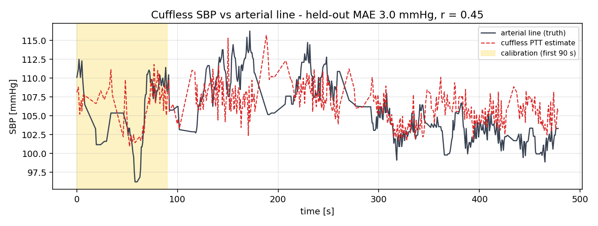
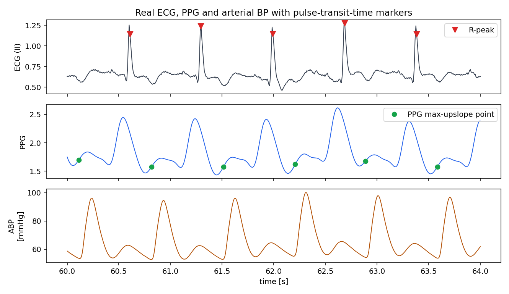
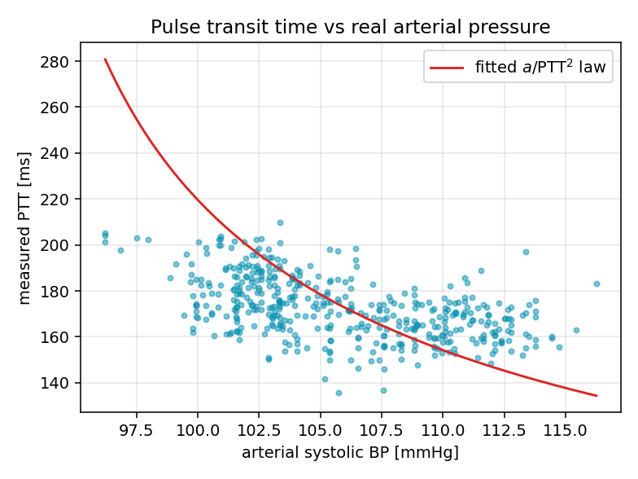

# Cuffless Blood Pressure from ECG and PPG

An experimental project: how far can pulse transit time alone go for estimating blood pressure? The estimate is checked against an invasive arterial line on a real intensive-care recording.



Pulse transit time (PTT) is the delay between the heartbeat on the ECG and the pulse arriving at the finger. Arteries stiffen as pressure rises, so the pulse travels faster and the delay gets shorter. Most cuffless blood-pressure wearables build on some version of this relationship.

The script finds each R-peak on the ECG (5–20 Hz band-pass) and the point of maximum upslope on the finger PPG, and takes the delay between them. Systolic pressure for the same beat comes from the arterial line. Motion and line-flush artifacts are removed with a MAD outlier test. The Bramwell–Hill relation `SBP = a/PTT² + b` is fitted on the first 90 seconds only, and the remaining seven minutes are predicted from ECG and PPG alone.



On held-out data the mean absolute error is 3.0 mmHg over 377 beats, with a correlation of r = 0.45. The low error partly comes from this patient's pressure only moving across about 20 mmHg, so any estimate near the mean scores well; the correlation shows the method follows the changes only partly. It is one record from one patient, so this is not a validation in the sense of ANSI/AAMI/ISO 81060-2, which needs at least 85 subjects.

At 125 Hz one sample is 8 ms, so a sample-indexed PTT takes only 9 distinct values in this record. Refining the R-peak and the upslope point to sub-sample precision with a parabolic fit gives 450 distinct values, but the result stays the same (MAE 2.99 vs 3.00 mmHg, r 0.453 vs 0.452), so quantization was not the limit. `python cuffless_bp_ptt.py --no-interp` reproduces the quantized version.

Other limits: single-site PTT includes the pre-ejection period, the calibration would drift over hours, and maximum upslope sits a near-constant offset away from the pulse foot (the calibration absorbs it).



## Run

```bash
pip install -r requirements.txt
python cuffless_bp_ptt.py
```

Figures go to `figures/` and the numbers to `metrics.txt`. `cuffless_bp_ptt.m` is a MATLAB version that gives the same numbers.

## Data

`data/bidmc_47_Signals.csv` is record 47 of the BIDMC PPG and Respiration Dataset (PhysioNet): 8 minutes at 125 Hz with ECG lead II, finger PPG and invasive arterial pressure. Citation and license details are in `data/README.md`.

This sits next to my work on wearable ultrasound blood-pressure monitoring ([FIWUS preprint](https://doi.org/10.21203/rs.3.rs-9000131/v1)), which approaches the same problem from artery-wall motion.

## License

Code is MIT (see `LICENSE`). The BIDMC data has its own license and citation requirements.

---

Yaşar Aykut Altuntop · Koç University · [LinkedIn](https://linkedin.com/in/aykutaltuntop) · [GitHub](https://github.com/Aykut0)
